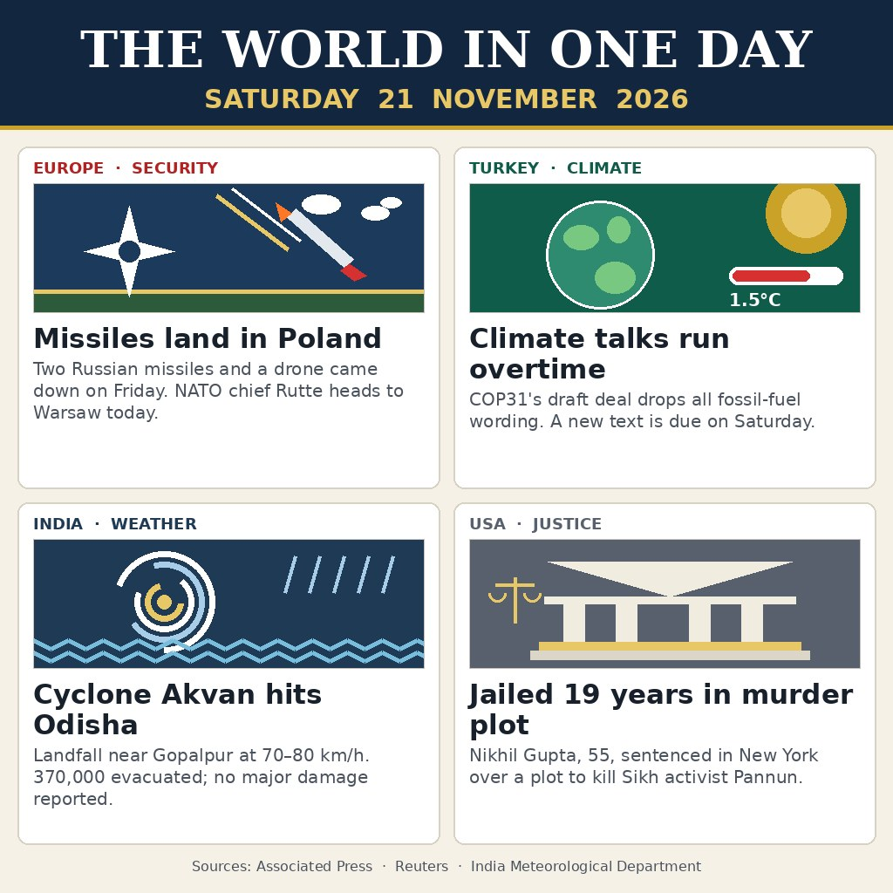

# The World in One Day — Saturday 21 November 2026

A one-image summary of Saturday 21 November 2026, built for the make.fun bounty
[news-image-20261121](https://make.fun/bounty/news-image-20261121).



## The four stories

Each story below was reported in the Saturday 21 November news cycle. Where an
event itself fell on Friday, the image and the notes below carry the genuinely
new Saturday development in that story — Rutte's Warsaw visit, the COP31
Saturday-morning draft, and Akvan's rain continuing through the 21st — so the
page reads as one day's news, not a round-up of the week.

- **Missiles land in Poland.** Two Russian missiles and a suspected drone came down in south-eastern Poland on Friday during a huge Russian air attack on Ukraine; Prime Minister Donald Tusk called it an "intentional provocation" and NATO Secretary-General Mark Rutte, who called it a "grave violation" of Polish airspace, was due in Warsaw on Saturday 21 November. Source: Associated Press, reported 20 November 2026 — <https://www.reflector.com/news/national/russian-missiles-land-in-poland-as-europe-held-military-drills-nearby-nato-calls-it-a/article_66cef298-02e8-53b4-94cf-1d56092ea027.html>
- **Climate talks run overtime.** The COP31 climate summit in Antalya, Turkey, slipped into overtime on Friday as nearly 200 countries quarrelled over fossil fuels and climate finance; the draft deal had stripped out every reference to fossil fuels and a $120 billion adaptation-finance target, with a third draft promised for Saturday morning. Source: Reuters, reported 20 November 2026 — <https://www.reuters.com/sustainability/cop/cop31-climate-talks-spill-into-overtime-nations-quarrel-over-fossil-fuels-2026-11-20/>
- **Cyclone Akvan hits Odisha.** Cyclonic Storm Akvan crossed the north Andhra Pradesh and south Odisha coasts near Gopalpur on Friday morning with winds of 70–80 km/h gusting to 90 km/h; about 370,000 people had been evacuated and officials reported no major damage or loss of life in the first hours after landfall, with heavy rain continuing into 21 November. Source: India Meteorological Department, bulletin of 20 November 2026 — <https://mausam.imd.gov.in/Forecast/marquee_data/Press%20Release%2020-11-2026.pdf>
- **Jailed 19 years in murder plot.** Indian national Nikhil Gupta, 55, was sentenced in a Manhattan federal court on Friday to 235 months — 19 years and seven months — in prison after pleading guilty to a murder-for-hire plot targeting Sikh separatist Gurpatwant Singh Pannun in New York. Source: Reuters, reported 20 November 2026 — <https://www.reuters.com/world/us/indian-man-sentenced-more-than-19-years-us-plotting-kill-sikh-separatist-2026-11-20/>

## How the image was made

The front page is a flat editorial design drawn entirely in code with Python's
Pillow library — no AI image generation, so every letter is crisp and nothing
is garbled. A navy masthead names the day, and a 2×2 grid gives each story a
simple flat-illustration motif (a compass star and missile for Poland, a globe
and 1.5 °C gauge for COP31, a cyclone spiral for Akvan, a courthouse for the
New York sentencing), a short headline, and one line carrying the key fact.
The finished image is 1024×1024 pixels, saved as a JPEG.

## Why these four?

They are the four most consequential stories in the 21 November news cycle,
and they span regions and fields rather than one country or one beat: European
security (Russian weapons landing on NATO soil), global climate (the COP31
endgame in Turkey), Asian weather (a cyclone landfall in India), and American
justice (a transnational murder-for-hire sentencing in New York). Each one
carries a checkable fact — a weapon count, a dropped dollar figure, a wind
speed and evacuation number, a 235-month sentence — and each was verified
against a live reputable source on the day. Stories from earlier in the week —
the Shenzhen trilateral summit, the ICJ Myanmar ruling and the market sell-off
— were deliberately left out: they belong to previous days' news, not this one.

## Running it

```sh
MAKEFUN_OUTPUT_DIR=out python3 main.py
```

This copies the shipped `entry.png` to `out/entry.png`. It uses only the
Python standard library, needs no network, and is deterministic — running it
twice produces byte-identical output.

Built for make.fun — try it yourself: https://make.fun/r/1e3qpbvy
